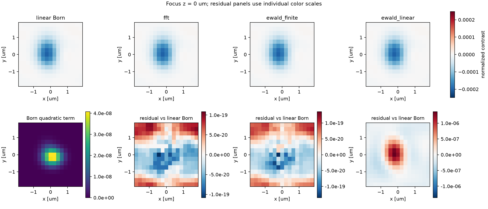
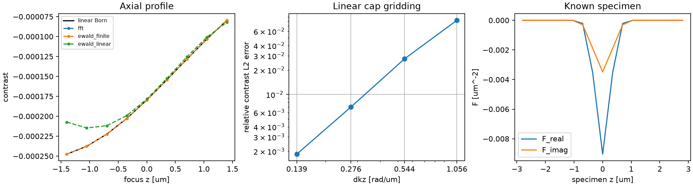

# 独立 Born 验证报告

复现日期：2026-10-21（Asia/Shanghai）。版本：wotfkit 0.1.1。环境：Python 3.12.13、JAX 0.12.0。本文完整示例在 CPU 运行；61 项测试在 CPU 和 CUDA GPU 各通过一次。
依赖以仓库 `uv.lock` 为准；当前实现统一使用角空间频率 k，并支持局部精度上下文。

## 算例与参考

- 计算网格 `(nz,ny,nx)=(17,15,17)`，`(dz,dy,dx)=(0.35,0.25,0.22)` μm。
- 真空波长 0.53 μm，背景折射率 1.33，检测 NA 0.6。
- 三个非相干平面波的 `(y,x)` 频率 bin 为 `(0,0),(1,2),(-1,1)`，强度权重为 `1,0.6,0.3`。
- 圆孔内 pupil 相位为 `0.25*(kx/cutoff)^2+0.13*ky/cutoff` rad，`cutoff=2πNA/λ₀`；背景 I₀=1.9。
- 实部、虚部散射势是分别偏心的负 Gaussian，幅度常数为 −0.01 和 −0.004 μm⁻²，
  仅中央五层非零；完整函数和参数见 `examples/validate_born.py::make_case`。
- 比较九个焦点：z=−1.4 到 +1.4 μm，步长 0.35 μm。最大绝对线性对比度为 `2.475877×10⁻⁴`。
- 独立双精度参考逐层形成 Born 散射场，在样品外出射面累加并经复 pupil 重聚焦，
  不调用 WOTF 的网格、传播核、相关或通道组装函数。
- 横向为周期边界；轴向是有限样品积分，WOTF 使用补零网格并只比较有效中央 ROI。

## 两通道预测误差

下表比较**对比度** `c=(I−I₀)/I₀`。相对 L2 的分母是参考对比度范数；
RMSE 和最大绝对误差均为无量纲对比度误差，不使用接近一的总强度掩盖误差。
“Born”列保留一阶散射场的二次强度项 `|uₛ|²`；“线性”列只保留干涉交叉项。

| 精度 | 方法 | 对线性参考相对 L2 | 对线性参考 RMSE | 对线性参考最大绝对误差 | 对含二次项 Born 的相对 L2 |
| --- | --- | ---: | ---: | ---: | ---: |
| float64 | FFT | 5.744388e-15 | 2.822718e-19 | 2.087089e-18 | 1.511902e-04 |
| float64 | Ewald finite | 5.743372e-15 | 2.822218e-19 | 2.059984e-18 | 1.511902e-04 |
| float64 | Ewald linear | 8.185573e-02 | 4.022284e-06 | 4.026093e-05 | 8.179999e-02 |
| float32 | FFT | 5.148793e-07 | 2.530050e-11 | 1.076974e-10 | 1.512730e-04 |
| float32 | Ewald finite | 5.069500e-07 | 2.491087e-11 | 1.223674e-10 | 1.511644e-04 |
| float32 | Ewald linear | 8.185584e-02 | 4.022290e-06 | 4.026102e-05 | 8.180011e-02 |

双精度的两条精确路线在本离散模型内达到浮点误差水平；单精度误差约 `5.1×10⁻⁷`，
均满足预定验收阈值。两条路线对含二次项 Born 强度约 `1.51×10⁻⁴` 的相对差异来自强度线性化。
公式选择及其依据见理论核查，而非通过拟合两算法的输出确定。



## 轴向线性落格收敛

保持物体、横向网格、dz 和九个焦点不变，仅扩大轴向补零计算范围，减小 dkz。
下表为双精度线性落格 Ewald 对独立线性 Born 的误差。

| nz | dkz [rad/μm] | 相对 L2 |
| ---: | ---: | ---: |
| 17 | 1.05599753 | 8.185573% |
| 33 | 0.54399873 | 2.744782% |
| 65 | 0.27618397 | 0.700752% |
| 129 | 0.13916247 | 0.184069% |

线性落格在 nz=129 时仍有约 0.184% 的误差，因此不能在任意有限网格上替代精确有限 lag 核。
单精度具有相同的落格误差趋势，详见 JSON。



## 强度线性化检查

同一散射势分别乘以下幅度因子，用独立模型计算 `c_Born−c_linear`。

| 散射势幅度因子 | 二次残差 L2 范数 | 残差相对线性对比度范数 |
| ---: | ---: | ---: |
| 1.0 | 3.558675e-7 | 1.511727e-4 |
| 0.5 | 8.896687e-8 | 7.558633e-5 |
| 0.25 | 2.224172e-8 | 3.779317e-5 |

绝对残差比例为 `1 : 1/4 : 1/16`，符合 `|uₛ|²` 的幅度平方关系。
一阶 Born 场强度依然忽略多重散射，该实验不能检验强散射样品。

## 测试与复现

```bash
uv sync --locked
uv run --locked pytest -q
uv run --locked python examples/validate_born.py --dtype float64
uv run --locked python examples/validate_born.py --dtype float32
uv build --offline
```

实测 **61 项测试通过（CPU 和 CUDA GPU）**。覆盖两种精度、默认双精度、精度上下文嵌套/覆盖/异常恢复及 x64 配置恢复、奇偶非方形网格、
各向异性采样、纯实/纯虚/混合样品、复 pupil、单个正入射与斜入射平面波、解析薄层符号与尺度、
角空间频率网格、PGT 通道符号组合、直接相关求和、有限轴向核、Nyquist 和非法输入、单位/权重缩放及轴向落格收敛。

机器可读原始结果：[双精度](validation/metrics_float64.json)、[单精度](validation/metrics_float32.json)。
示例运行还在 `artifacts/` 下生成对应 JSON 和 PNG，图像不需要联网生成。

## 尚未解决与适用范围

1. 原稿 Green 积分、三维谱和最终 FDT 有符号冲突。库根据 Helmholtz 方程固定了定义，
   但缺失 `WOTFconfig` 和旧脚本下游调用，不能完整追溯其外部标度补偿。
2. 线性落格存在上述可量化误差，仍需按具体样品与频率网格检查收敛。
3. 验证限定于离散周期横向样品和有限轴向切片；没有宣称消除连续样品的空间积分、角度离散和视场截断误差。
4. 未包含多重散射、反射、倏逝波、掠入射、矢量偏振或界面效应；没有离网格光源插值。
5. 精确 Ewald 与 FFT 对应同一个有限 lag 算子；它们相等只是一项一致性证据。
   物理符号与尺度另外通过独立场模型、解析薄层和单位缩放检查。

详细公式和原源码核查见 [theory_audit.md](theory_audit.md)。
